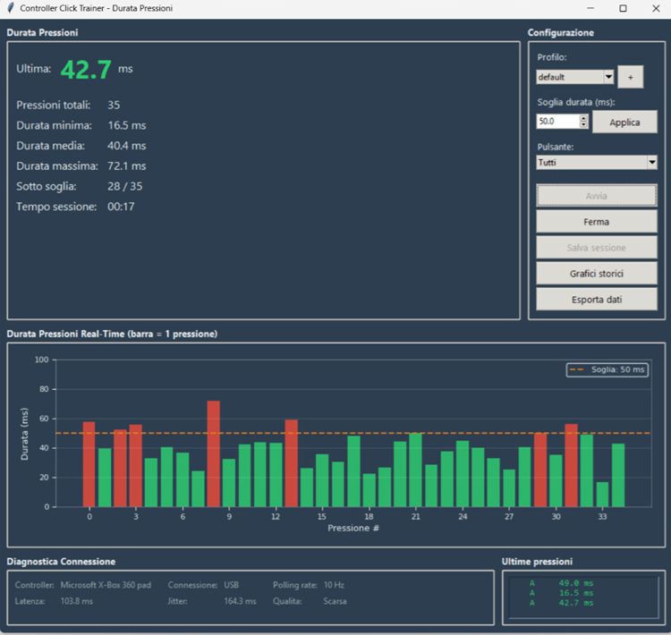

# Controller Click Trainer

[🇬🇧 English](#english) | [🇮🇹 Italiano](#italiano)

---

## English

Desktop application to monitor and train **press duration** on gaming controllers (Xbox, DS4Windows).
Measures in milliseconds how long a button stays pressed, provides visual feedback against a configurable threshold and saves statistics to track progress.



### What it's for

In many competitive games, the duration of a button press directly influences gameplay (e.g., more or less powerful actions based on press time). This tool helps you:

- **Measure** the exact duration of each press in ms
- **Train** quick taps: the goal is to stay **below** a target threshold
- **Verify** if the controller is "extending" inputs compared to your intention
- **Compare** USB vs Bluetooth performance
- **Track** progress over time

### Features

- **Duration of each press**: records press and release, calculates duration in ms
- **Real-time bar chart**: each bar = 1 press, green if below threshold, red if above
- **Inverted threshold**: the goal is to stay **below** the target (e.g., below 50ms = fast tap)
- **Press log**: scrollable list with duration and button for each press
- **All buttons**: A, B, X, Y, LB, RB, LT, RT, LS, RS, D-Pad, Start, Back
- **User profiles**: multiple profile management with separate CSVs
- **History charts**: duration progress, distribution, diagnostics
- **Controller diagnostics**: real polling rate, latency, jitter, connection quality
- **Language**: English and Italian with flag switcher

### System Requirements

- Windows 10/11
- Xbox controller or compatible (also DS4Windows with Xbox emulation)

### Installation

#### Option 1: Download Standalone Exe (recommended for end users)

**No Python installation required!**

1. Go to [Releases](https://github.com/AlbGri/controller-click-trainer/releases)
2. Download the latest version: `ControllerClickTrainer-vX.X.X-windows.zip`
3. Extract the ZIP file to a folder
4. Run `ControllerClickTrainer.exe`

The `config\settings.json` file next to the exe can be edited to customize colors and thresholds.

##### Windows SmartScreen Warning

On first launch, Windows Defender SmartScreen may show a warning "Unrecognized app" or "Windows protected your PC".

**This is normal for unsigned open source applications.**

**How to proceed**:
1. Click on **"More info"**
2. Click on **"Run anyway"**
3. The application will start normally

**Why does this happen?**
- The exe does not have a digital signature (certificates cost $200-400/year)
- Windows blocks all unsigned exe files downloaded from the Internet as a precaution

**Is it safe?**
- Completely open source and inspectable code
- No Internet connection during use
- No data sent to external servers
- You can compile the exe yourself from source (see Build Exe below)

#### Option 2: Run from Source (for developers)

**Requirements**: Python 3.8+ (recommended 3.12 via Miniconda)

##### 1. Clone the repository

```bash
git clone https://github.com/AlbGri/controller-click-trainer.git
cd controller-click-trainer
```

##### 2. Create conda environment

```bash
conda create -n click-trainer python=3.12 -y
conda activate click-trainer
```

##### 3. Install dependencies

```bash
pip install -r requirements.txt
```

##### 4. Launch

```bash
python src/main.py
```

### Quick Start

1. Connect the controller to the PC
2. Launch the application
3. Set the target threshold in ms (default: 50ms)
4. Select the button to monitor (or "All")
5. Press **Start** and begin pressing
6. Each press appears as a bar in the chart: green = below threshold (good), red = above (too long)
7. The large number shows the duration of the last press
8. Press **Stop** then **Save session**

### Project Structure

```
controller-click-trainer/
├── src/
│   ├── main.py               # Entry point (supports PyInstaller exe)
│   ├── controller_monitor.py  # Controller detection, tracks press/release
│   ├── data_manager.py        # Data, profiles, CSV management
│   ├── diagnostics.py         # Diagnostics: polling rate, latency, jitter
│   ├── visualizer.py          # Matplotlib charts (real-time bars + history)
│   ├── translations.py        # EN/IT translations
│   └── gui.py                 # Tkinter GUI
├── config/
│   └── settings.json          # Application configuration
├── data/                      # Saved sessions (CSV)
├── docs/
│   └── usage_guide.md         # Detailed usage guide
├── ControllerClickTrainer.spec  # PyInstaller config for exe build
├── requirements.txt
├── .gitignore
└── LICENSE
```

### Troubleshooting

#### Controller not detected
- Verify that the controller is on and connected
- If using DS4Windows, ensure Xbox emulation is active
- Try disconnecting and reconnecting the controller

#### Press not registered
- The press is registered only on button **release** (needs press + release)
- If pressing too quickly, it might seem not to register: check the log at bottom right

#### Module import error
- Verify you activated the environment: `conda activate click-trainer`
- Reinstall dependencies: `pip install -r requirements.txt`

### Dependencies

| Library | Use |
|---|---|
| matplotlib | Real-time bar charts and history |
| numpy | Numerical calculations |
| inputs | Controller input reading (press/release) |
| tkinter | GUI (included in Python) |

### Build Exe (for developers)

To create the standalone exe:

```bash
conda activate click-trainer
pip install pyinstaller
pyinstaller ControllerClickTrainer.spec --noconfirm
```

The exe will be in `dist\ControllerClickTrainer\ControllerClickTrainer.exe`.

Then copy the configuration next to the exe, where the app reads it:

```powershell
Copy-Item -Path "dist\ControllerClickTrainer\_internal\config" -Destination "dist\ControllerClickTrainer\config" -Recurse -Force
```

### License

MIT License - see [LICENSE](LICENSE)

---

## Italiano

Applicazione desktop per monitorare e allenare la **durata delle pressioni** sui controller gaming (Xbox, DS4Windows).
Misura in millisecondi quanto tempo un tasto resta premuto, fornisce feedback visivo rispetto a una soglia configurabile e salva le statistiche per tracciare i progressi.


### A cosa serve

In molti giochi competitivi, la durata della pressione di un tasto influenza direttamente il gameplay (es. azioni più o meno potenti in base al tempo di pressione). Questo tool ti aiuta a:

- **Misurare** la durata esatta di ogni singola pressione in ms
- **Allenare** i tap rapidi: l'obiettivo è stare **sotto** una soglia target
- **Verificare** se il controller sta "allungando" gli input rispetto alla tua intenzione
- **Confrontare** le prestazioni USB vs Bluetooth
- **Tracciare** i progressi nel tempo

### Funzionalità

- **Durata ogni pressione**: registra press e release, calcola durata in ms
- **Grafico a barre real-time**: ogni barra = 1 pressione, verde se sotto soglia, rosso se sopra
- **Soglia invertita**: l'obiettivo è stare **sotto** il target (es. sotto 50ms = tap veloce)
- **Log pressioni**: lista scrollabile con durata e pulsante di ogni pressione
- **Tutti i pulsanti**: A, B, X, Y, LB, RB, LT, RT, LS, RS, D-Pad, Start, Back
- **Profili utente**: gestione multipla con CSV separati
- **Grafici storici**: progressi durate, distribuzione, diagnostica
- **Diagnostica controller**: polling rate reale, latenza, jitter, qualità connessione
- **Lingua**: Inglese e italiano con selettore a bandiera

### Requisiti Sistema

- Windows 10/11
- Controller Xbox o compatibile (anche DS4Windows con emulazione Xbox)

### Installazione

#### Opzione 1: Download Exe Standalone (consigliato per utenti finali)

**Nessuna installazione Python richiesta!**

1. Vai alla pagina [Releases](https://github.com/AlbGri/controller-click-trainer/releases)
2. Scarica l'ultima versione: `ControllerClickTrainer-vX.X.X-windows.zip`
3. Estrai il file ZIP in una cartella
4. Esegui `ControllerClickTrainer.exe`

Il file `config\settings.json` accanto all'exe può essere modificato per personalizzare colori e soglie.

##### Windows SmartScreen Warning

Al primo avvio, Windows Defender SmartScreen potrebbe mostrare un avviso "App non riconosciuta" o "Windows ha protetto il PC".

**Questo è normale per applicazioni open source non firmate digitalmente.**

**Come procedere**:
1. Clicca su **"Ulteriori informazioni"** (o "More info")
2. Clicca su **"Esegui comunque"** (o "Run anyway")
3. L'applicazione si avvierà normalmente

**Perché succede?**
- L'exe non ha una firma digitale (i certificati costano $200-400/anno)
- Windows blocca per precauzione tutti gli exe non firmati scaricati da Internet

**È sicuro?**
- Codice completamente open source e ispezionabile
- Nessuna connessione Internet durante l'uso
- Nessun dato inviato a server esterni
- Puoi compilare l'exe tu stesso dal sorgente (vedi Build Exe più sotto)

#### Opzione 2: Esecuzione da Sorgente (per sviluppatori)

**Requisiti**: Python 3.8+ (consigliato 3.12 via Miniconda)

##### 1. Clona il repository

```bash
git clone https://github.com/AlbGri/controller-click-trainer.git
cd controller-click-trainer
```

##### 2. Crea environment conda

```bash
conda create -n click-trainer python=3.12 -y
conda activate click-trainer
```

##### 3. Installa dipendenze

```bash
pip install -r requirements.txt
```

##### 4. Avvia

```bash
python src/main.py
```

### Uso Rapido

1. Collega il controller al PC
2. Avvia l'applicazione
3. Imposta la soglia target in ms (default: 50ms)
4. Seleziona il pulsante da monitorare (o "Tutti")
5. Premi **Avvia** e inizia a premere
6. Ogni pressione appare come barra nel grafico: verde = sotto soglia (bene), rosso = sopra (troppo lungo)
7. Il numero grande mostra la durata dell'ultima pressione
8. Premi **Ferma** poi **Salva sessione**

### Struttura Progetto

```
controller-click-trainer/
├── src/
│   ├── main.py               # Entry point (supporta exe PyInstaller)
│   ├── controller_monitor.py  # Rilevamento controller, traccia press/release
│   ├── data_manager.py        # Gestione dati, profili, CSV
│   ├── diagnostics.py         # Diagnostica: polling rate, latenza, jitter
│   ├── visualizer.py          # Grafici matplotlib (barre real-time + storici)
│   ├── translations.py        # Traduzioni EN/IT
│   └── gui.py                 # Interfaccia grafica tkinter
├── config/
│   └── settings.json          # Configurazione applicazione
├── data/                      # Sessioni salvate (CSV)
├── docs/
│   └── usage_guide.md         # Guida uso dettagliata
├── ControllerClickTrainer.spec  # Config PyInstaller per build exe
├── requirements.txt
├── .gitignore
└── LICENSE
```

### Troubleshooting

#### Controller non rilevato
- Verifica che il controller sia acceso e connesso
- Se usi DS4Windows, assicurati che l'emulazione Xbox sia attiva
- Prova a scollegare e ricollegare il controller

#### Pressione non registrata
- La pressione viene registrata solo al **rilascio** del tasto (serve press + release)
- Se premi troppo velocemente, potrebbe sembrare che non registri: guarda il log in basso a destra

#### Errore import moduli
- Verifica di aver attivato l'environment: `conda activate click-trainer`
- Reinstalla le dipendenze: `pip install -r requirements.txt`

### Dipendenze

| Libreria | Uso |
|---|---|
| matplotlib | Grafici barre real-time e storici |
| numpy | Calcoli numerici |
| inputs | Lettura input controller (press/release) |
| tkinter | Interfaccia grafica (incluso in Python) |

### Build Exe (per sviluppatori)

Per creare l'exe standalone:

```bash
conda activate click-trainer
pip install pyinstaller
pyinstaller ControllerClickTrainer.spec --noconfirm
```

L'exe sarà in `dist\ControllerClickTrainer\ControllerClickTrainer.exe`.

Poi copia la configurazione accanto all'exe, dove l'app la legge:

```powershell
Copy-Item -Path "dist\ControllerClickTrainer\_internal\config" -Destination "dist\ControllerClickTrainer\config" -Recurse -Force
```

### Licenza

MIT License - vedi [LICENSE](LICENSE)
